<p align="center">
  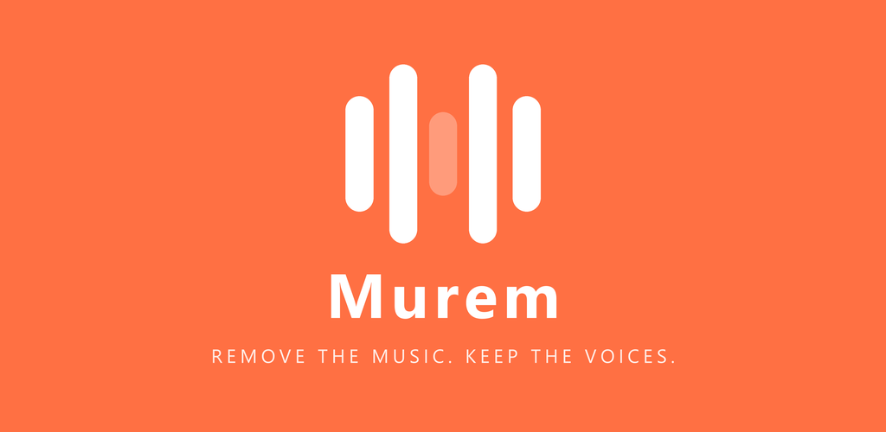
</p>

# Murem: Video Music Remover

[](https://github.com/Ignema/youtube-music-remover/releases/latest)
[](https://f-droid.org/packages/com.musicremover.app/)
[](https://colab.research.google.com/github/Ignema/youtube-music-remover/blob/master/vocals.ipynb)
[](https://huggingface.co/spaces/melnema/youtube-music-remover)

Remove the background music from any video or audio file and keep the voices and dialogue.

Murem uses AI vocal separation. It takes links from YouTube, Instagram, TikTok, Vimeo and 1000+ other sites through yt-dlp, as well as local files. It comes as an Android app that can work entirely on the phone, a server for your PC, a web UI and a Jupyter notebook.

## Android App

Download `murem-arm64-v8a-release.apk` from the [latest release](https://github.com/Ignema/youtube-music-remover/releases/latest), or get Murem from [F-Droid](https://f-droid.org/packages/com.musicremover.app/).

| APK | For |
|-----|-----|
| `murem-arm64-v8a-release.apk` | Almost all current phones |
| `murem-armeabi-v7a-release.apk` | Older 32-bit phones |
| `murem-x86_64-release.apk` | Emulators and x86 devices |
| `murem-universal-release.apk` | Any device (much larger) |

### Three ways to process

| Mode | Where it runs | Good for |
|------|---------------|----------|
| **Internal (on-device)** | On the phone, with ONNX Runtime | No setup, nothing leaves the phone |
| **Local (Termux)** | The Murem server in Termux on the same phone | All server models, offline |
| **Server** | The Murem server on your PC (or Docker) | Speed, GPU, the RoFormer models |

Pick one in **Settings → Processing mode**.

### Features

**Input**
- Links from any yt-dlp site, several at once: paste, add, or import a `.txt`
- Local video and audio files (MP4, MKV, WebM, MP3, M4A and more)
- Share links or files from any app; Murem opens the right mode
- Built-in yt-dlp, updated from **Settings → Update yt-dlp** when links stop working

**Output**
- MP4 with the original video, or audio only as MP3 or M4A
- Bitrate 128k, 192k or 320k
- On-device performance settings: threads, quality or speed, batch size, and a time estimate while processing

**Sites that need a login**
- Log in with the built-in browser, or import a `cookies.txt`
- Cookies are kept per site, can be switched on or off per site, stay on the device and are excluded from backups

**Player and history**
- Built-in player with an audio waveform: tap to play or pause, drag to seek, 10 s skip, loop, fullscreen
- Open in an external player (VLC, MX Player and others); the screen stays on while playing
- Recent results show where each was made (On device, Termux or Server), with search, details, save, share and export all
- Processing queue that survives app restarts, with notification actions

**Design**
- One input card for links and files, and Settings split into clear sections
- Light, Dark, Black (OLED) and System themes; Material You on Android 12+, or one of 8 color palettes
- Home screen widget with 4 themes, 16 languages

### Models

| Model | Internal | Termux / Server | Notes |
|-------|:--------:|:---------------:|-------|
| MDX-NET HQ3 | ✓ | ✓ | Fast, good default for phones |
| MDX-NET Voc FT | ✓ | | Cleanest vocals on most songs |
| MDX-NET 3_9662 | ✓ | | 30 MB, fastest, for low-end phones |
| UVR KARA 2 | ✓ | ✓ | Keeps only the lead vocal |
| Kim Vocal 2 | ✓ (optional) | ✓ (server default) | On-device download needs a license notice |
| Mel-Band RoFormer | | ✓ | State of the art, GPU recommended |
| BS-RoFormer | | ✓ | Premium quality |
| Any `audio-separator` model | | ✓ | Custom model name |

On-device models download on first use (30 to 67 MB each) and can be deleted in **Settings → On-device models**.

### Screenshots

<p align="center">
  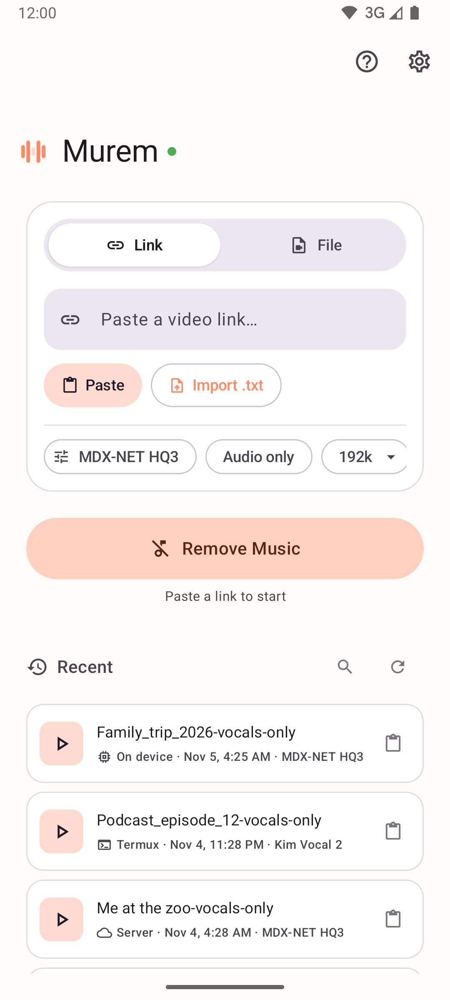
  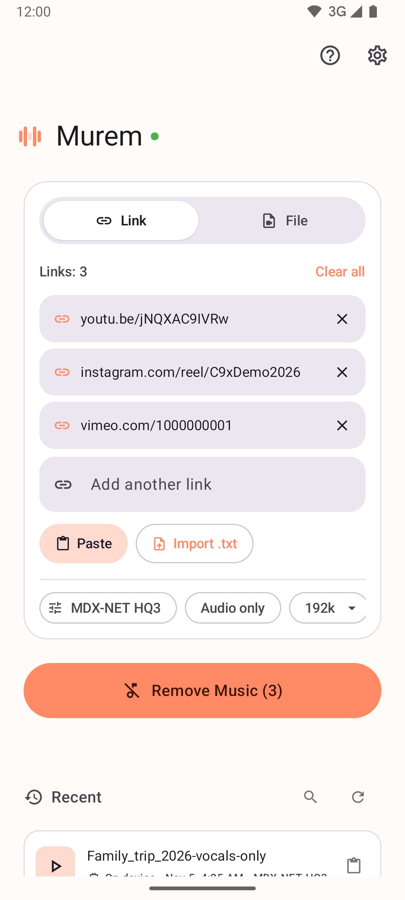
  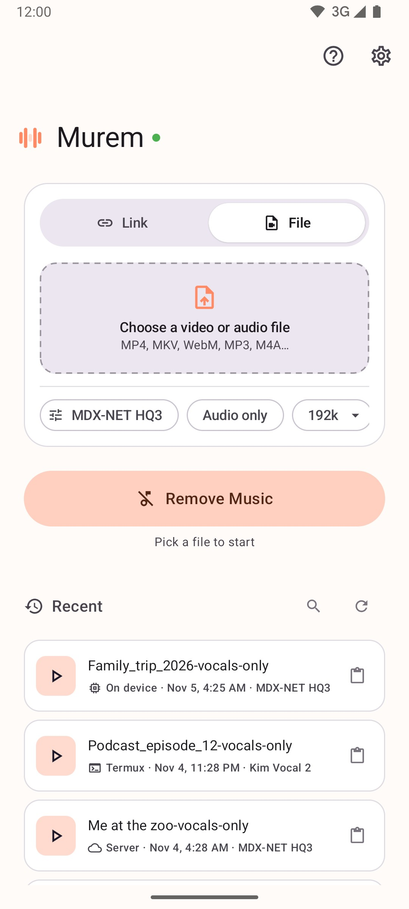
  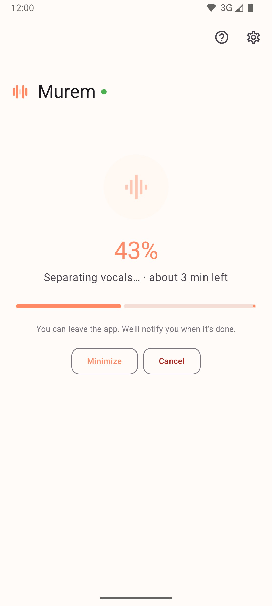
</p>
<p align="center">
  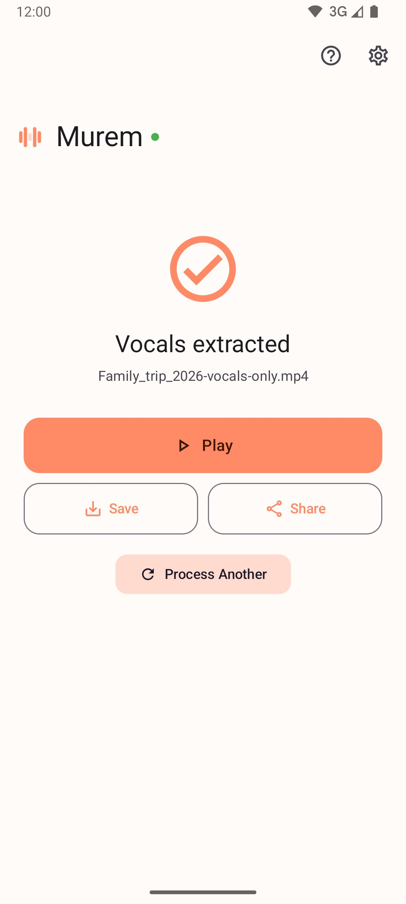
  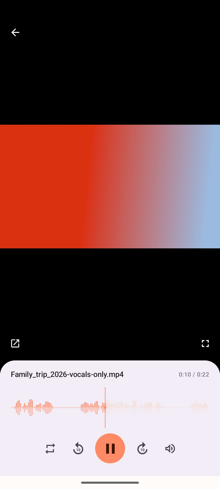
  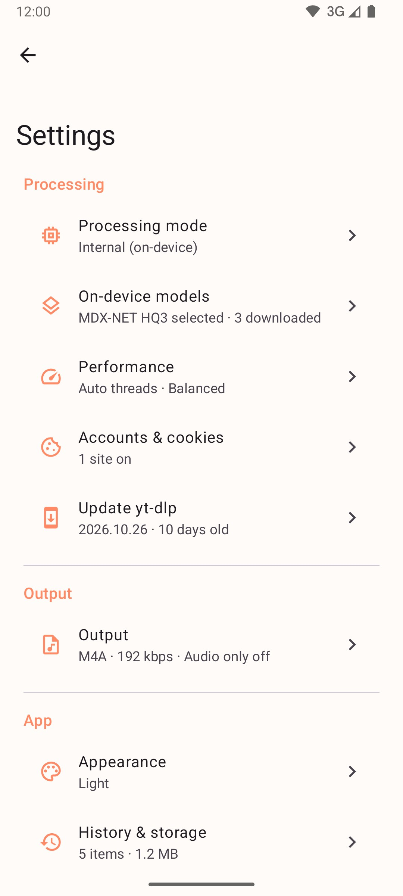
  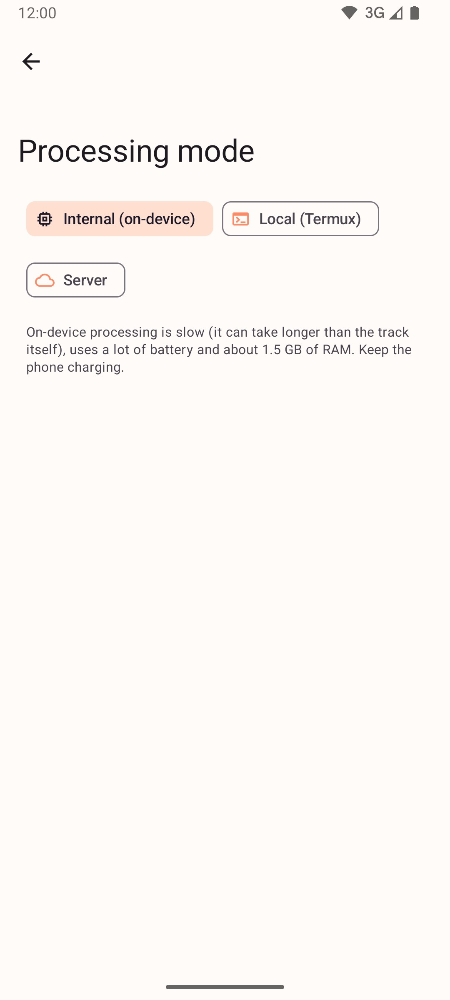
</p>
<p align="center">
  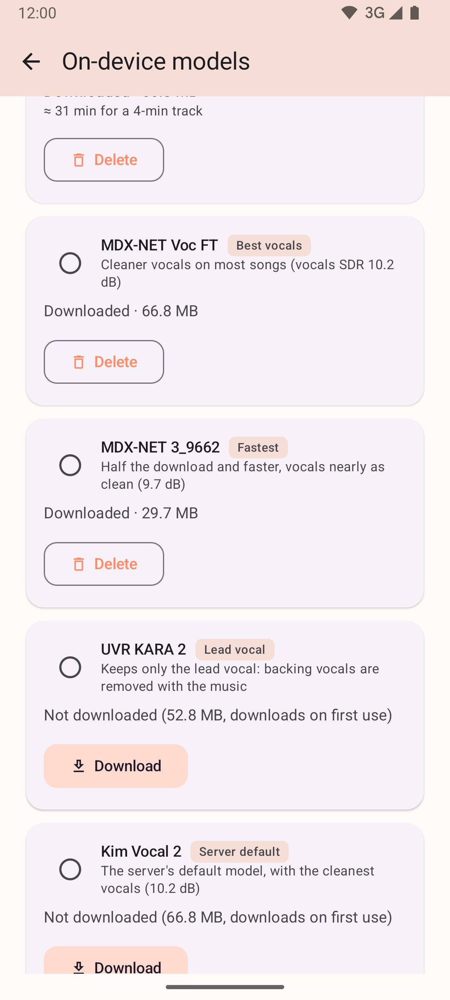
  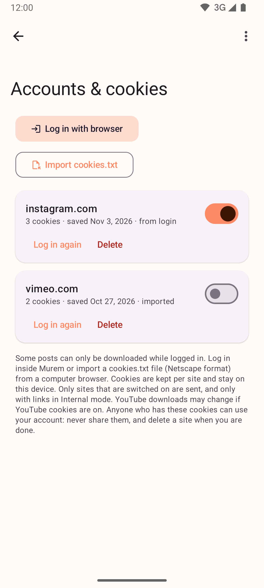
  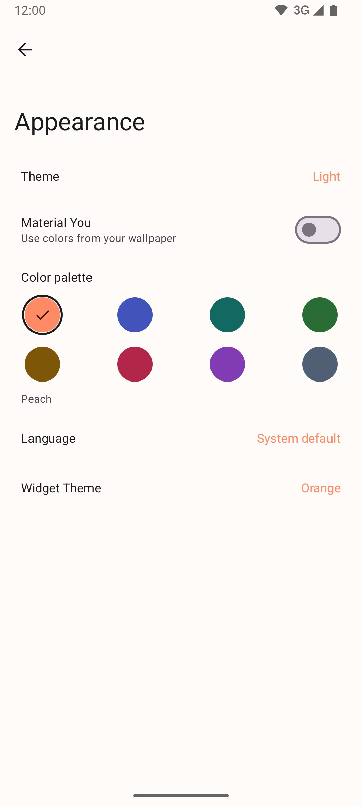
  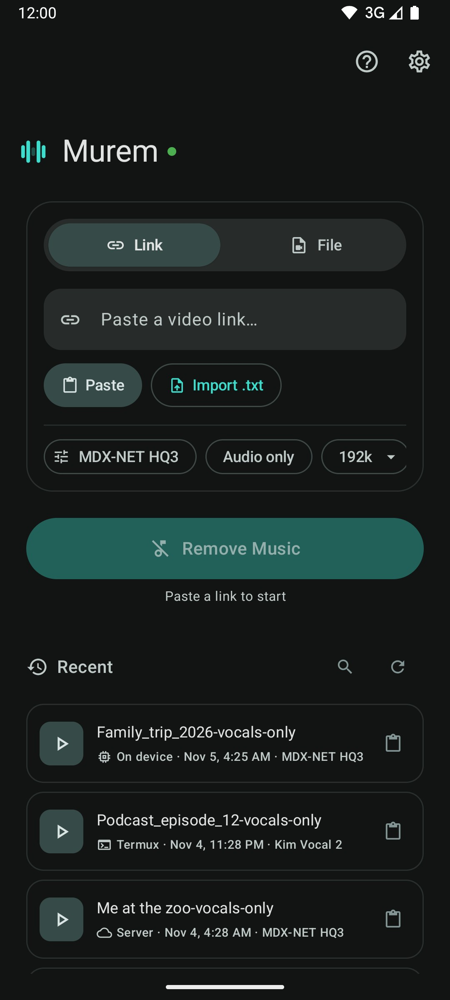
</p>

### Quick Start (On-Device, no setup)

1. Install the APK
2. Settings → Processing mode → **Internal (on-device)**
3. Paste a link or pick a file and tap **Remove Music**. The model downloads the first time
4. For links, tap **Settings → Update yt-dlp** once after installing

On-device processing is slow on most phones (it can take longer than the track) and uses a lot of battery and about 1.5 GB of RAM, so keep the phone charging for long videos.

### Quick Start (Remote Server)

1. Install the APK on your phone
2. On your PC, clone and start the server:
```bash
git clone https://github.com/Ignema/youtube-music-remover.git
cd youtube-music-remover
uvx --with fastapi --with yt-dlp --with python-multipart --with "audio-separator[gpu]" --with audioread --with zeroconf uvicorn api.main:app --host 0.0.0.0 --port 8000
```

3. In the app, go to Settings → Processing mode → **Server** and tap **Auto-discover on network** (or enter your PC's IP)
4. Paste a video link and tap Remove Music

### Quick Start (On-Device with Termux)

1. Install [Termux from F-Droid](https://f-droid.org/packages/com.termux/)
2. In Termux, enable external apps: edit `~/.termux/termux.properties` and set `allow-external-apps = true`
3. In Murem, go to Settings → Permissions and grant all
4. Settings → Processing mode → **Local (Termux)** → tap **Install** (wait for it to finish in Termux)
5. Tap **Start**; the server starts in the background
6. Go home and process videos. After app updates, tap **Update Server** in the same screen

**Manual setup (run it yourself):** if you prefer to run the setup in Termux yourself instead of tapping Install, run:

```bash
pkg install -y curl
curl -fsSLO https://raw.githubusercontent.com/Ignema/youtube-music-remover/master/android/termux-setup.sh
bash termux-setup.sh
```

Then start the server with `~/start-music-remover.sh`, or tap Start in the app. The setup installs CPU-only PyTorch (no CUDA downloads) and takes ffmpeg from apt, not pip. If an older install already downloaded the CUDA packages, remove its Python environment and run the setup again:

```bash
proot-distro login ubuntu -- rm -rf /root/venv
bash termux-setup.sh
```

### Docker (Easiest for PC)

```bash
cd api
docker build -t murem .
docker run -p 8000:8000 murem
```

## Notebook / Web UI

### Requirements

- Python 3.8+
- FFmpeg
- CUDA GPU (optional, speeds up processing)

### Installation

```bash
git clone https://github.com/Ignema/youtube-music-remover.git
cd youtube-music-remover
uv venv && uv pip install -e .
```

Install FFmpeg: `winget install ffmpeg` (Windows) / `sudo apt install ffmpeg` (Linux) / `brew install ffmpeg` (Mac)

### Usage

**Notebook:**
```bash
jupyter notebook vocals.ipynb
```

**Web UI (Gradio):**
```bash
python app.py
```

**API Server:**
```bash
uvicorn api.main:app --host 0.0.0.0 --port 8000
```

## API Endpoints

| Method | Path | Description |
|--------|------|-------------|
| GET | `/health` | Health check (includes GPU status) |
| GET | `/api/models` | List available models and bitrates |
| GET | `/api/info?url=` | Get video metadata (any yt-dlp URL) |
| POST | `/api/process` | Start processing a URL |
| POST | `/api/upload` | Upload and process a local file |
| POST | `/api/batch` | Queue multiple URLs |
| GET | `/api/status/{job_id}` | Get job status, progress, and metadata |
| POST | `/api/cancel/{job_id}` | Cancel a running job |
| GET | `/api/download/{job_id}` | Download the result |
| GET | `/api/waveform/{job_id}` | Get pre-computed waveform data |
| WS | `/ws/{job_id}` | WebSocket for real-time progress |

## Server Models (API)

Model names for `/api/process` and `/api/upload`. The Android app's on-device models are listed in [Models](#models).

| Model | Type | Description |
|-------|------|-------------|
| `Kim_Vocal_2.onnx` | MDX-Net | Default. Best MDX-Net quality |
| `UVR-MDX-NET-Inst_HQ_3.onnx` | MDX-Net | Fast and lightweight |
| `UVR_MDXNET_KARA_2.onnx` | MDX-Net | Karaoke-style separation |
| `vocals_mel_band_roformer.ckpt` | Roformer | State-of-the-art. GPU recommended |
| `model_bs_roformer_ep_317_sdr_12.9755.ckpt` | Roformer | Premium quality |
| Any `audio-separator` model | Various | Custom model support |

## License

MIT License. See [LICENSE](LICENSE) for details.

The Android APK also bundles third-party components under their own licenses: youtubedl-android and its FFmpeg build (GPL-3.0), LAME (LGPL-2.0), yt-dlp (Unlicense) and ONNX Runtime (MIT). The APK as distributed follows the GPL-3.0 terms of those components; the source in this repository stays MIT.

## Disclaimer

This tool is for educational and personal use only. You are responsible for complying with the terms of service of video platforms, copyright laws, and obtaining necessary permissions before processing content you don't own.
